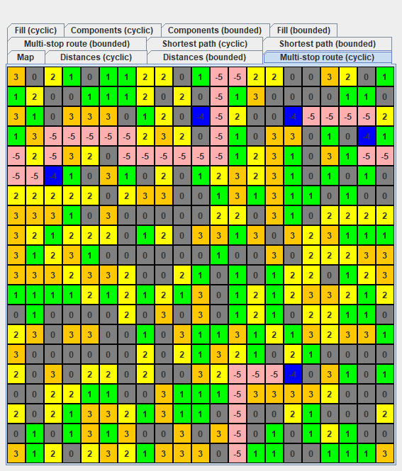
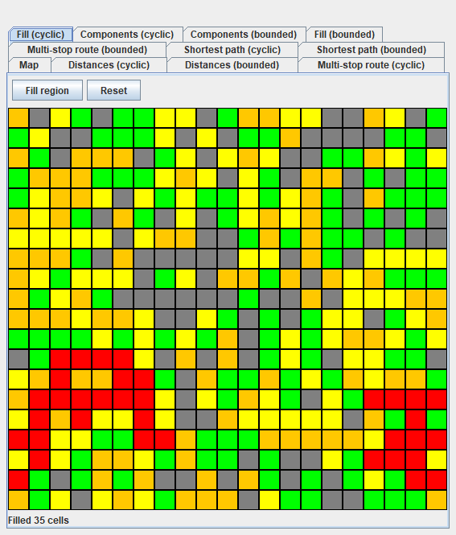

# Grid Algorithms Visualizer

An academic Java/Swing project that implements and visualizes algorithms on a two-dimensional grid. It supports bounded maps and maps whose opposite edges are connected.



## Features

- BFS distance maps and shortest paths between two points, avoiding obstacle cells.
- A greedy route that visits several target points.
- Flood fill of a connected area.
- Connected-component counting and visualization.
- Side-by-side examples for cyclic and bounded grids, presented in 11 tabs.
- Fill and Reset controls for the preset region.

The two-point paths are shortest paths. The multi-stop route uses a nearest-neighbor heuristic; it does not guarantee a globally optimal traveling-salesperson route.

## Run on Windows

Install a JDK version 21 or newer. Double-click **Run.cmd**. The launcher detects JDKs through `JAVA_HOME`, `PATH`, or the `.jdks` directory used by IntelliJ IDEA, then compiles and starts the application. No additional runtime libraries are needed.

From PowerShell:

```powershell
.\run.ps1
```

To compile and create a runnable JAR without opening the application:

```powershell
.\run.ps1 -BuildOnly
java -jar build/grid-algorithms-visualizer.jar
```

The launcher can build a runnable JAR locally on Java 21 or newer.

The demo displays the fixed course example defined in `Ex3.main`. Gray cells are obstacles in the pathfinding tabs, blue cells identify targets, and pink cells show the route. The Fill tabs recolor a preset region; Reset restores the sample map.



## Build and test with Maven

With Maven and JDK 21 or newer:

```sh
mvn test
mvn package
java -jar target/grid-algorithms-visualizer.jar
```

The test suite includes 18 course-derived tests and 10 regression/property tests. Seeded randomized checks compare distance maps, paths, flood fill, and connected components against an independent BFS implementation. Additional cases cover route direction, disconnected targets, invalid inputs, and duplicate targets.

An optional desktop smoke check opens the real Swing window, visits every tab, checks grid visibility, and exercises both Fill and Reset controls:

```powershell
.\run.ps1 -CheckGui
```

## Structure

```text
src/main/java/     Map implementation, interfaces, coordinates, and Swing demo
src/test/java/     Course-derived tests and independent regression tests
tools/            Desktop GUI smoke check
docs/images/      Screenshots from an actual run
```

## Coursework and maintenance

The project originates from Ishay Ishon's Introduction to Computing coursework. The interfaces and initial scaffold supplied by the course retain their original author comments, including credit to Boaz Ben-Moshe.

A 2026 maintenance pass corrected UI behavior, aligned route handling with the documented interface, added regression checks, and packaged the project for easier execution. That pass used AI assistance. The original submitted files remain unchanged outside this portfolio copy. See [CHANGELOG.md](CHANGELOG.md) for the changes and verification scope.
